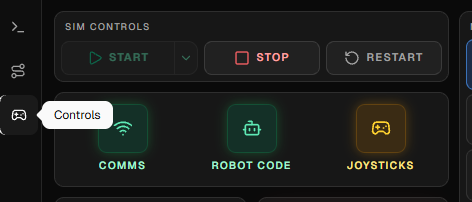
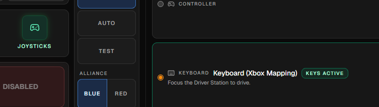
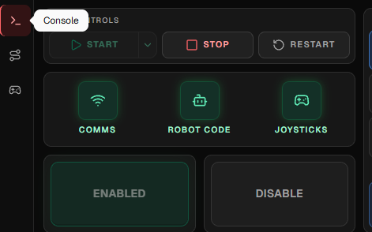

# Command-Based Robot

In lesson 7 you put code in `teleopPeriodic()`, and it ran every loop. That works for small
programs, but most competition robots are written in the **command-based** style instead.
The robot is split into:

- **subsystems**: parts of the robot, like a drivetrain or a shooter.
- **commands**: actions those parts can do, like "drive forward 2 meters".

Every loop, WPILib's **command scheduler** runs whichever commands are active. `Robot.java`
already sets that up, so you don't need to edit it.

This project has one subsystem, `Drive`, and six commands that are already written for you:

| Command                                   | What it does                                  |
| ----------------------------------------- | --------------------------------------------- |
| `new DriveForwardCommand(drive, meters)`  | moves forward                                 |
| `new DriveBackwardCommand(drive, meters)` | moves backward                                |
| `new DriveLeftCommand(drive, meters)`     | slides sideways to the left, without turning  |
| `new DriveRightCommand(drive, meters)`    | slides sideways to the right, without turning |
| `new TurnLeftCommand(drive, degrees)`     | turns left (counterclockwise) in place        |
| `new TurnRightCommand(drive, degrees)`    | turns right (clockwise) in place              |

This `Drive` is a pretend drivetrain with no motors. Each command jumps the robot to its new
spot all at once and then finishes right away. The robot starts at `(2, 2)` on the field,
facing along the field's x direction (to the right in AdvantageScope). Its position is logged
as `Drive/Pose`.

## What you're making

A robot that drives itself in a square during autonomous, controller buttons that move and
turn it, and an A button that drives a figure eight shaped like the 8 on a digital clock.
You'll watch the robot move on the field in AdvantageScope.

## Where does my code go?

You'll work in one file: **`RobotContainer.java`**, in the `src/main/java/frc/robot/` folder.

- **Step 1** changes the `autoChooser.addDefaultOption(...)` line inside `RobotContainer()`.
- **Steps 2 and 3** add lines inside the braces after `private void configureButtonBindings()`.
- **Step 3** also adds a new method of your own, right under `configureButtonBindings()`.

The commands (in the `commands/` folder) and `Drive` (in `subsystems/drive/`) are done for
you. You just use them.

## How to run your code

Robot projects don't use the Run button. Use the **Driver Station** at the bottom of the page:

1. Click **Start**.
2. Wait for **Comms** and **Robot Code** to turn green.
3. Under **Mode**, click **Auto** or **Teleop**. Each step tells you which one.
4. Click **Enable**.

After you change your code, click **Restart** to run the new version, then click **Enable**
again.

> **Heads up:** when you click **Restart**, the project deletes any `import` lines you aren't
> using yet. Add each import at the same time as the code that uses it.

## Steps

### 1. Drive a square in autonomous

Open `RobotContainer.java`. Inside `RobotContainer()`, this line sets up the autonomous
command, the command that runs when you enable **Auto**:

```java
autoChooser.addDefaultOption("Do Nothing", Commands.none());
```

The text is the name of the option, and `Commands.none()` is a command that does nothing.

The commands live in a different folder (package), so each one needs an import. Add these at
the top of the file, with the other imports:

```java
import frc.robot.commands.DriveForwardCommand;
import frc.robot.commands.TurnLeftCommand;
```

Then replace the whole `addDefaultOption` line with this:

```java
autoChooser.addDefaultOption(
    "Square",
    Commands.sequence(
        new DriveForwardCommand(drive, 2.0),
        new TurnLeftCommand(drive, 90.0),
        Commands.waitSeconds(0.5)
        // TODO: add sides 2, 3, and 4 here
        ));
```

- `Commands.sequence(...)` makes one command out of several. It runs them one after another,
  starting each one when the one before it finishes.
- `Commands.waitSeconds(0.5)` is a command that just waits half a second. Without it, the
  whole square would take less than a fifth of a second, and you'd never see it move.
- The three lines inside `sequence(...)` are one side of the square: drive, turn, wait.

Replace the `TODO` with three more sides, so the robot drives all the way around. Copy the
three lines of side 1 and paste them three times.

> **Common mistake:** missing commas. Every command inside `sequence(...)` needs a comma after
> it, except the very last one. If one is missing, Java stops with an error like
> `')' expected`.

> **Check your work:** click **Restart** and wait for **Comms** and **Robot Code** to turn
> green. Under **Mode**, click **Auto**.
>
> 1. Click **AdvantageScope** in the top bar of CodeRunner. Inside AdvantageScope, click the
>    **2D Field** tab. You'll see a picture of the field, with a section called **Poses**
>    underneath it.
> 2. In the list on the left, open `AdvantageKit`, then `RealOutputs`, then `Drive`.
> 3. Drag `Pose` from the list and drop it on the **Poses** section. A robot shows up on the
>    field.
> 4. Click **Enable**. The robot should drive a 2-meter square, one side every half second,
>    and end back at `(2, 2)` facing the same way it started.
>
> Click **Disable** when it's done.

> **Think about it:** the robot starts at `(2, 2)`, and the bottom edge of the field is
> y = 0. If you used `TurnRightCommand` instead, which way would the square go? With 3-meter
> sides, would the robot stay on the field?

### 2. Drive with controller buttons

Button bindings go inside `configureButtonBindings()`. There's already one there:

```java
controller.b().onTrue(Commands.runOnce(drive::resetPose, drive));
```

- `controller.b()` is the B button.
- `onTrue(...)` starts a command once, at the moment the button is pressed.
- `Commands.runOnce(drive::resetPose, drive)` is a command that calls `resetPose()` on
  `drive`. That jumps the robot back to its starting spot at `(2, 2)`. Leave it as it is.

Add these imports with the others:

```java
import frc.robot.commands.DriveBackwardCommand;
import frc.robot.commands.DriveLeftCommand;
import frc.robot.commands.DriveRightCommand;
import frc.robot.commands.TurnRightCommand;
```

Then add this inside `configureButtonBindings()`, under the B line:

```java
controller.povUp().onTrue(new DriveForwardCommand(drive, 1.0));
controller.povDown().onTrue(new DriveBackwardCommand(drive, 1.0));
controller.povLeft().onTrue(new DriveLeftCommand(drive, 1.0));
controller.povRight().onTrue(new DriveRightCommand(drive, 1.0));
controller.leftBumper().onTrue(new TurnLeftCommand(drive, 45.0));
// TODO: make the right bumper turn right 45 degrees
```

`povUp()` is up on the D-pad (the plus-shaped pad), and `leftBumper()` is the left bumper.
Replace the `TODO` with a line that uses `rightBumper()` and `TurnRightCommand`, the same way
the left bumper line does.

Now try it out with your keyboard:

1. Click **Restart** and wait for **Comms** and **Robot Code** to turn green.
2. Click the **Controls** tab on the left side of the Driver Station.

   

3. Choose **Keyboard (Xbox Mapping)**. Check that the **Joysticks** light turns green.

   

4. Click the **Console** tab to go back. Under **Mode**, click **Teleop**. Make sure
   **Joysticks** is still green, then click **Enable**. Buttons don't run commands while the
   robot is disabled.

   

5. Click on the Driver Station, then press these keys and watch the robot in AdvantageScope:

   | Key   | Button        | What the robot does    |
   | ----- | ------------- | ---------------------- |
   | **Z** | D-pad up      | drives forward 1 m     |
   | **X** | D-pad down    | drives backward 1 m    |
   | **C** | D-pad left    | slides left 1 m        |
   | **V** | D-pad right   | slides right 1 m       |
   | **E** | left bumper   | turns left 45°         |
   | **U** | right bumper  | turns right 45°        |
   | **L** | B             | jumps back to `(2, 2)` |

> **Common mistake:** pressing the keys while your code is open and selected. The letters get
> typed into your code instead of pressing buttons. Click on the Driver Station first, then
> press the keys.

> **Check your work:** each press should move or turn the robot exactly once. Holding a key
> down shouldn't keep it moving.

> **Think about it:** press **E** to turn 45°, then press **Z**. Which way does "forward" go
> now? Press **C**. Is "left" still the left side of the screen?

### 3. Drive a figure eight with the A button

Your figure eight is two squares stacked on top of each other, like the 8 on a digital clock.
From the starting spot, the robot drives a square turning **left** (the top half of the 8),
then a square turning **right** (the bottom half).

A command object can only be used once, so instead of building the square right in the
button line, you'll write a **method** that builds a brand-new square every time you call
it. Add this inside the `RobotContainer` class, right under the closing `}` of
`configureButtonBindings()`:

```java
private Command leftLoop() {
  return Commands.sequence(
      new DriveForwardCommand(drive, 1.5),
      new TurnLeftCommand(drive, 90.0),
      Commands.waitSeconds(0.5),
      new DriveForwardCommand(drive, 1.5),
      new TurnLeftCommand(drive, 90.0),
      Commands.waitSeconds(0.5),
      new DriveForwardCommand(drive, 1.5),
      new TurnLeftCommand(drive, 90.0),
      Commands.waitSeconds(0.5),
      new DriveForwardCommand(drive, 1.5),
      new TurnLeftCommand(drive, 90.0),
      Commands.waitSeconds(0.5));
}
```

- `Command` before `leftLoop` means the method gives back a command.
- Each time you call `leftLoop()`, it runs the `new` lines again and makes new command
  objects.

Under `leftLoop()`, write a `rightLoop()` method. Copy all of `leftLoop()`, rename it to
`rightLoop`, and change every `TurnLeftCommand` to `TurnRightCommand`.

Then add this inside `configureButtonBindings()`, under your other buttons:

```java
controller.a().onTrue(Commands.sequence(leftLoop(), rightLoop()));
```

> **Common mistake:** making one command and using it twice, like
> `Command loop = leftLoop();` and then `Commands.sequence(loop, loop)`. The robot program
> stops with an error that starts `Cannot compose a command twice in the same composition!`.
> Call `leftLoop()` again each time you need a new one.

> **Check your work:** click **Restart**, click **Teleop**, then **Enable**. Click on the
> Driver Station, press **L** to make sure the robot is at `(2, 2)`, then press **K** (the A
> button). The robot should drive the top square, then the bottom square, and end back at
> `(2, 2)` facing the same way it started.

> **Think about it:** your auto square from step 1 is almost the same as `leftLoop()`. How
> could you change the `addDefaultOption` line to use `leftLoop()` instead?

## Bonus

- **Drive smoothly while a button is held down.** `whileTrue(...)` starts a command when the
  button is pressed and stops it when the button is let go. But these commands finish right
  away, and `whileTrue` doesn't start them again. `.repeatedly()` makes a command start over
  every time it finishes. Add this inside `configureButtonBindings()`, then hold **I** (the
  Y button):

  ```java
  controller.y().whileTrue(new DriveForwardCommand(drive, 0.02).repeatedly());
  ```

  The robot moves `0.02` meters every loop, 50 times a second. How fast is that in meters per
  second? Then make the X button (**J**) turn the robot slowly while it's held down.

- **Add a command of your own.** Make a new class in the `commands` folder (right-click the
  folder, choose **Create a new class/command**, then **Empty Class**). Copy everything from
  `DriveForwardCommand.java` into it, then change the class name and constructor to match
  your file name. A command can also do a little bit every loop: put code in an `execute()`
  method (it runs every loop while the command is active) and make `isFinished()` return
  `true` only when it's done.
