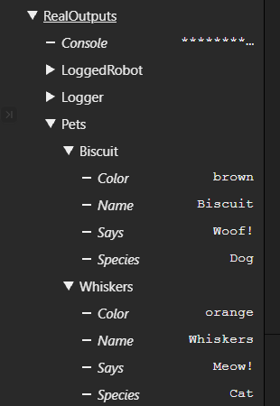
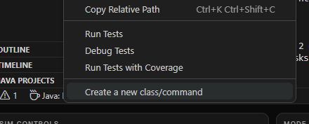
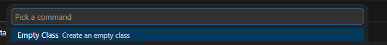
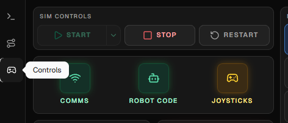
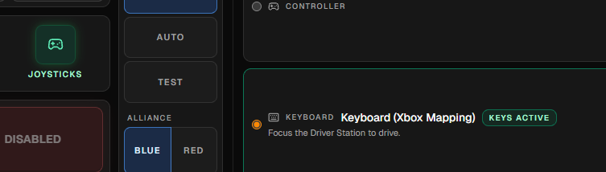
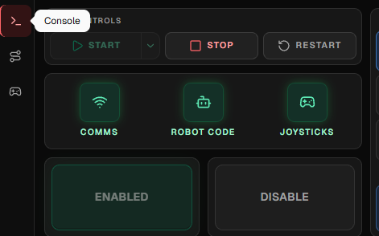
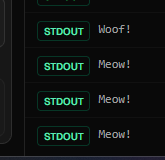

# Pets

In lesson 5 you built a class for each shape. Every shape knew how to work out its own
perimeter and area. This time you'll build classes for pets, and each kind of pet knows how
to **speak** in its own way.

Then you'll learn how to treat different classes as the same *kind* of thing. A `Cat` and a
`Dog` are different classes, but they're both pets. Once Java knows that, you can keep them
all in one list and handle every pet with a single loop.

## What you're making

A `Cat` class and a `Dog` class. Each pet has a name, a color, and a species, and a `speak()`
method that returns what it says. You'll send each pet's info to AdvantageScope. Then you'll add a
`Pet` interface so one loop can log every pet, add a pet of your own, and finish by making
each pet speak when you press a controller button. When you're done, AdvantageScope will show
something like this:



## Where does my code go?

You'll work in two places, both in the `src/main/java/frc/robot/` folder:

- **New files you create**: `Cat.java`, `Dog.java`, `Pet.java`, and one more for a pet you
  choose.
- **`RobotContainer.java`**, which is already there. Find the comment that says
  `// Start working here!`. It's inside the braces after `public RobotContainer()`. That's
  where you create your pets and log their info. The code there runs once, when the robot
  program starts.

Everything else in the project is already set up for you.

## How to run your code

Robot projects don't use the Run button. Use the **Driver Station** at the bottom of the page:

1. Click **Start**.
2. Wait for **Comms** and **Robot Code** to turn green.

You don't have to click **Enable** until the last step. After you change your code, click
**Restart** to run the new version.

## Steps

### 1. Create the `Cat` class

Each class goes in its own file. To make the file for `Cat`:

1. In the file list on the left, open `src`, then `main`, then `java`, then `frc`, until you
   can see the `robot` folder. That's the folder `RobotContainer.java` is in.
2. Right-click the `robot` folder and choose **Create a new class/command**.

   

3. Choose **Empty Class**.

   

4. Type the name `Cat` and press **Enter**.

Replace everything in `Cat.java` with this:

```java
package frc.robot;

public class Cat {
  private String name;
  private String color;
  private final String species = "Cat";
}
```

- A `String` is a piece of text, like `"Whiskers"` or `"orange"`. A `double` field holds a
  number, but a cat's name, color, and species are words, so they go in `String` fields.
- Every `Cat` object will remember its own `name` and `color`.
- `species` is set to `"Cat"` right where it's created. Every cat is a cat, so it's the same
  for every `Cat` object and doesn't need to be passed in.
- `final` means the field can never change after it's set. A cat will never turn into a dog.

### 2. Add a constructor and getters

A **constructor** runs once, when an object is created. It has the same name as the class
and no return type, and its job is to fill in the fields. Add this under the fields:

```java
public Cat(String name, String color) {
  this.name = name;
  // TODO: copy the color parameter into the color field
}
```

`this.name` means "the field", and plain `name` means "the parameter that was passed in". So
`this.name = name;` copies the name that was passed in into the field. Replace the `TODO` with
a line that does the same thing for `color`.

Then add a **getter** for the name, under the constructor:

```java
public String getName() {
  return name;
}
```

- `String` before `getName` means the method gives back a `String`.
- `return name;` hands back whatever the `name` field holds. The field is `private`, so other
  classes can't read it directly, but they can call `getName()` to ask for it.

Under `getName()`, write a `getColor()` getter that returns the `color` field, and a
`getSpecies()` getter that returns the `species` field. They look just like `getName()`.

> **Common mistake:** writing `color = color;` without `this.` copies the parameter onto
> itself and never touches the field. The field stays empty.

### 3. Add `speak()`

Add this method inside the `Cat` class, under your getters:

```java
public String speak() {
  // TODO: return what a cat says
}
```

Replace the `TODO` with a `return` line that returns what a cat says, like `"Meow!"`. Text you
type yourself goes inside double quotes. The program won't compile until you do, because
`speak()` promises to return a `String`.

> **Common mistake:** forgetting the quotes. `return Meow!;` makes Java look for a variable
> called `Meow`, and it stops with an error. Write `return "Meow!";` instead.

### 4. Create a cat and make it speak

Open `RobotContainer.java`. `Logger.recordOutput` sends a value to AdvantageScope. It needs
an import, so add this line at the top of the file, under `package frc.robot;`:

```java
import org.littletonrobotics.junction.Logger;
```

Then add this inside `RobotContainer()`, right under the `// Start working here!` comment:

```java
Cat cat = new Cat("Whiskers", "orange");

// Log info about your cat
Logger.recordOutput(cat.getName() + "/Name", cat.getName());
Logger.recordOutput(cat.getName() + "/Color", cat.getColor());
Logger.recordOutput(cat.getName() + "/Species", cat.getSpecies());
Logger.recordOutput(cat.getName() + "/Says", cat.speak());
```

- The name and color are text, so they go in double quotes when you create the cat.
- `cat.getName() + "/Says"` builds the key from the cat's name. For this cat it makes
  `"Whiskers/Says"`, so the value shows up in a `Whiskers` folder.
- The value is whatever the method after the comma returns. For `Says`, that's your
  `speak()` method.

You can use any name and color you like.

> **Check your work:** click **Restart** and wait for **Comms** and **Robot Code** to turn
> green. Click **AdvantageScope** in the top bar of CodeRunner. In the list on the left, open
> `AdvantageKit`, then `RealOutputs`, then your cat's name. Click the arrow next to each value
> to open it. You should see your cat's `Color`, `Name`, `Says`, and `Species`.

> **Think about it:** if you change the cat's name to `"Mittens"` and click **Restart**, what
> will the key be? You didn't change the `recordOutput` line, so why does it change?

### 5. Create the `Dog` class

Make a new class called `Dog`, the same way you made `Cat`. Replace everything in `Dog.java`
with everything from `Cat.java`, then change these things:

1. The class name, `Cat`, becomes `Dog`, in both the class line and the constructor.
2. The `species` field is set to `"Dog"` instead of `"Cat"`.
3. `speak()` returns what a dog says instead, like `"Woof!"`.

The other fields and the getters stay exactly the same. Every pet has a name, a color, and a
species.

Then add this in `RobotContainer()`, under your cat code:

```java
Dog dog = new Dog("Biscuit", "brown");

// Log info about your dog
Logger.recordOutput(dog.getName() + "/Name", dog.getName());
Logger.recordOutput(dog.getName() + "/Color", dog.getColor());
Logger.recordOutput(dog.getName() + "/Species", dog.getSpecies());
Logger.recordOutput(dog.getName() + "/Says", dog.speak());
```

> **Common mistake:** copying the cat lines and only changing some of the `cat`s to `dog`.
> Each line has `cat` in it twice. If you miss one, your dog's info ends up in your cat's
> folder, or the other way around.

> **Common mistake:** if you forget to rename the constructor, Java stops with an error like
> `invalid method declaration; return type required`. A constructor must have the same name as
> its class, so in `Dog.java` it has to be `public Dog(...)`.

> **Check your work:** click **Restart**. In AdvantageScope, your dog's folder should now be
> next to your cat's. Open it and check that its species is `Dog` and it says something
> different from your cat.

### 6. Create the `Pet` interface

Right now `Cat` and `Dog` are two separate classes. You know they're both pets, but Java
doesn't. To Java, they have nothing to do with each other.

An **interface** fixes that. It's a list of methods that a class promises to have. Make a new
class called `Pet`, the same way as before, then replace everything in `Pet.java` with this:

```java
package frc.robot;

public interface Pet {
  String getName();

  String getColor();

  String getSpecies();

  String speak();
}
```

- It says `interface`, not `class`.
- The methods have no body, just a `;`. Each pet class fills in the bodies itself.

Now make both classes keep the promise. Change the class line in `Cat.java` to:

```java
public class Cat implements Pet {
```

Do the same in `Dog.java`, with `Dog` instead of `Cat`.

`Cat` and `Dog` already have all four of these methods, so you don't need to add anything
else.

> **Check your work:** click **Restart**. Nothing in AdvantageScope should change. That's
> expected! The program still running means both classes keep the `Pet` promise.

> **Think about it:** try it out. In `Dog.java`, rename `speak()` to `bark()` and look at the
> error. What is Java telling you? Change it back to `speak()` before you go on.

### 7. Log every pet with one loop

Because `Cat` and `Dog` both implement `Pet`, Java knows each one *is a* `Pet`. That means one
**array** can hold both. An array stores several values in one variable. The `[]` after the
type means "an array of", and the values go inside `{ }`:

```java
Pet[] pets = {cat, dog};
```

A **for-each loop** runs its code once for every value in an array. Add this to the end of
`RobotContainer()`:

```java
Pet[] pets = {cat, dog};
for (Pet pet : pets) {
  // Log info about every pet
  Logger.recordOutput("Pets/" + pet.getName() + "/Name", pet.getName());
  // TODO: log Color, Species, and Says the same way
}
```

The first line is done for you. It's the same as your cat's `Name` line, but with `pet`
instead of `cat`, and `"Pets/" +` at the start of the key. For the cat it makes
`"Pets/Whiskers/Name"`. Replace the `TODO` with three more lines that do the same for
`Color`, `Species`, and `Says`.

> **Don't skip this:** delete the logging lines from steps 4 and 5, all eight of them: the
> four under `// Log info about your cat` and the four under `// Log info about your dog`.
> The loop logs every pet now. Keep the lines that create `cat` and `dog`, because the array
> needs them.

- `pet` holds the next pet each time around the loop: first your cat, then your dog.
- `pet.speak()` runs the `speak()` method of whichever pet it's holding. The cat meows and the
  dog woofs, even though the line of code is the same.

> **Common mistake:** putting quotes around `pet.getName()`. `"Pets/" + "pet.getName()"`
> makes the key `Pets/pet.getName()/Name` for every pet. Without the quotes, Java calls the
> method and uses the name it returns.

> **Common mistake:** writing `Cat[] pets = {cat, dog};`. An array of `Cat`s can only hold
> cats, so Java won't let the dog in. Use `Pet[]`, which can hold anything that implements
> `Pet`.

> **Check your work:** click **Restart**. In AdvantageScope, open `RealOutputs`, then `Pets`.
> Both of your pets should be in there, each with all four values. (The old folders from steps 4
> and 5 may still be in the list from the last run. The `Pets` folder is the one to check.)

### 8. Add a pet of your own

Pick any animal you like: a hamster, a parrot, a fish, a dragon. Make a new class for it that
implements `Pet`, the same way you made `Dog`: copy `Cat.java`, rename the class and
constructor, set its `species`, and write its own `speak()`.

Then, in `RobotContainer()`:

1. Create one of your new pets, under your dog.
2. Add it to the array: `{cat, dog, yourPet}`.

> **Check your work:** click **Restart**. Your new pet should be in the `Pets` folder with the
> other two, with its own species and saying its own thing.

> **Think about it:** how many lines did you change in the loop to log your new pet? How many
> would you have needed if you were still logging each pet by itself, like in step 4?

### 9. Make your pets speak with the controller

So far your pets speak once, when the program starts. Now you'll paste in some controller
code so each pet speaks when you press a button. You'll learn how controllers and commands
work in a later lesson. For now, just paste the code and change one name.

Add these two imports at the top of `RobotContainer.java`, under the `Logger` import:

```java
import edu.wpi.first.wpilibj2.command.InstantCommand;
import edu.wpi.first.wpilibj2.command.button.CommandXboxController;
```

Then paste this at the very end of `RobotContainer()`, after your loop:

```java
CommandXboxController controller = new CommandXboxController(0);

controller.a().onTrue(new InstantCommand(() -> System.out.println(cat.speak())));
controller.b().onTrue(new InstantCommand(() -> System.out.println(dog.speak())));
controller.x().onTrue(new InstantCommand(() -> System.out.println(yourPet.speak())));
controller.y().onTrue(new InstantCommand(() -> {
  for (Pet pet : pets) {
    System.out.println(pet.speak());
  }
}));
```

When you click **Restart**, the project tidies up your code's spacing automatically, so the
Y button lines may get split up differently. That's fine. The code still does the same thing.

Change `yourPet` to the name of the variable you made for your pet in step 8. If you gave
your cat or dog variables different names, change those too.

- `controller.a()` is the A button. `onTrue(...)` runs a command once, each time the button is
  pressed.
- `() ->` means "here's some code to run later". The code doesn't run now, when the program
  starts. It runs each time the button is pressed.
- The Y button runs the same kind of loop you wrote in step 7, so every pet speaks at once.

> **Common mistake:** pasting the code above the lines that create your pets, or outside the
> braces of `RobotContainer()`. Java stops with a `cannot find symbol` error because the
> button code can't see your pet variables yet. Paste it at the very end, just before the
> closing `}` of `RobotContainer()`.

Now try it out with your keyboard:

1. Click **Start** (or **Restart**, if it's already running) and wait for **Comms** and
   **Robot Code** to turn green.
2. Click the **Controls** tab on the left side of the Driver Station.

   

3. Choose **Keyboard (Xbox Mapping)**. Check that the **Joysticks** light turns green.

   

4. Click the **Console** tab to go back. Make sure **Joysticks** is still green, then click
   **Enable**. Buttons don't do anything while the robot is disabled.

   

5. Press these keys. Each press should print what that pet says in the console.

   | Key   | Button | Who speaks  |
   | ----- | ------ | ----------- |
   | **K** | A      | your cat    |
   | **L** | B      | your dog    |
   | **J** | X      | your pet    |
   | **I** | Y      | every pet   |

   

> **Common mistake:** pressing the keys while your code is open and selected. The letters get
> typed into your code instead of pressing buttons. Click on the Driver Station first, then
> press the keys.

## Bonus

- **Teach your dog a trick only dogs know.** Add a `fetch()` method to `Dog` (but not to the
  `Pet` interface) that returns something like `"Fetched the ball!"`. Try calling
  `pet.fetch()` inside the loop. Why won't Java allow it, even when `pet` is holding the dog?
  Call `dog.fetch()` outside the loop instead, and log it under `Pets/<name>/Trick`.
- **Think about it:** what happens in AdvantageScope if two of your pets have the same name?
  Try it and see. How could you change the key so both still show up?
