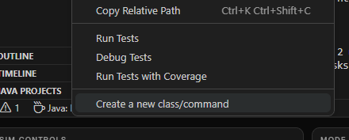
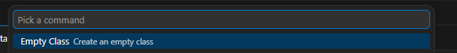

# Perimeter and Area Part 2

In lesson 3 you calculated the perimeter and area of shapes, all inside one `main` method.
This time, each kind of shape gets its own **class**.

A class is a blueprint. It describes what a thing *remembers* (its **fields**) and what it
can *do* (its **methods**). Once you have a blueprint, you can build as many **objects** from
it as you like: one `Rectangle` class can make a 3-by-5 rectangle, a 10-by-2 rectangle, and
so on.

## What you're making

`Rectangle`, `Triangle`, and `Circle` classes that each know how to calculate their own
perimeter and area. You'll create one of each shape and send its measurements, perimeter,
and area to AdvantageScope, grouped by shape (for example `Rectangle/Area`).

## Where does my code go?

You'll work in two places, both in the `src/main/java/frc/robot/` folder:

- **New files you create**, one for each shape: `Rectangle.java`, `Triangle.java`, and
  `Circle.java`.
- **`RobotContainer.java`**, which is already there. Find the comment that says
  `// Start working here!`. It's inside the braces after `public RobotContainer()`. That's
  where you create your shapes and log their values. The code there runs once, when the
  robot program starts.

Everything else in the project is already set up for you.

## How to run your code

Robot projects don't use the Run button. Use the **Driver Station** at the bottom of the page:

1. Click **Start**.
2. Wait for **Comms** and **Robot Code** to turn green.

You don't have to click **Enable** for this lesson. After you change your code, click
**Restart** to run the new version.

## Steps

### 1. Create the `Rectangle` class

Each class goes in its own file. To make the file for `Rectangle`:

1. In the file list on the left, open `src`, then `main`, then `java`, then `frc`, until you
   can see the `robot` folder. That's the folder `RobotContainer.java` is in.
2. Right-click the `robot` folder and choose **Create a new class/command**.

   

3. A list pops up at the top of the editor. Choose **Empty Class**.

   

4. Type the name `Rectangle` and press **Enter**. Use a capital R, and don't add `.java`.

A new file called `Rectangle.java` opens, with a `package frc.robot;` line and an empty
`Rectangle` class already in it. Replace everything in the file with this:

```java
package frc.robot;

public class Rectangle {
  private double length;
  private double width;
}
```

- `package frc.robot;` goes at the top of every file in this folder.
- `length` and `width` are **fields**: values that every `Rectangle` object remembers.
- `private` means only code inside the `Rectangle` class can use them directly.

> **Common mistake:** the file name and the class name must match exactly, including the
> capital letter. `Rectangle.java` holds `public class Rectangle`. If they don't match, Java
> won't compile.

### 2. Add a constructor

A **constructor** runs once, when an object is created. It has the same name as the class
and no return type. Its job is to fill in the fields.

Add this inside the `Rectangle` class, under the two fields:

```java
public Rectangle(double length, double width) {
  this.length = length;
  this.width = width;
}
```

The constructor's inputs (its **parameters**) have the same names as the fields.
`this.length` means "the field", and plain `length` means "the parameter that was passed in".
So `this.length = length;` copies the number that was passed in into the field.

> **Common mistake:** writing `length = length;` without `this.` copies the parameter onto
> itself and never touches the field. The field stays `0.0`.

### 3. Add the methods

Add these four methods inside the `Rectangle` class, under the constructor:

```java
public double getLength() {
  return length;
}

public double getWidth() {
  return width;
}

public double perimeter() {
  // Write the perimeter formula here, using length and width.
}

public double area() {
  // Write the area formula here, using length and width.
}
```

- `double` before the method name means the method gives back a `double`.
- `return` hands that answer back to whoever called the method.
- `public` means other classes, like `RobotContainer`, are allowed to call it.
- `getLength()` and `getWidth()` are **getters**. The fields are `private`, so
  `RobotContainer` can't read them directly, but it can call these methods to ask for them.

The getters are done for you. Replace the comment in `perimeter()` and in `area()` with a
`return` line that does the math. The program won't compile until you do, because those
methods promise to return a `double`.

- **Perimeter** is the distance all the way around the outside. Picture walking around the
  rectangle: how many sides do you walk, and how long is each one?
- **Area** is the amount of space inside.

> **Think about it:** work it out by hand first. A rectangle with length `3` and width `5`
> should have perimeter `16.0` and area `15.0`. You'll check your code against these numbers
> in step 4.

### 4. Create a rectangle and log it

Open `RobotContainer.java`. `Logger.recordOutput` sends a value to AdvantageScope. It needs
an import, so add this line at the top of the file, under `package frc.robot;`:

```java
import org.littletonrobotics.junction.Logger;
```

Then add this inside `RobotContainer()`, right under the `// Start working here!` comment:

```java
Rectangle rectangle = new Rectangle(3, 5);

Logger.recordOutput("Rectangle/Length", rectangle.getLength());
Logger.recordOutput("Rectangle/Width", rectangle.getWidth());
Logger.recordOutput("Rectangle/Perimeter", rectangle.perimeter());
Logger.recordOutput("Rectangle/Area", rectangle.area());
```

- `new Rectangle(3, 5)` builds a `Rectangle` object, running your constructor with
  `length = 3` and `width = 5`.
- `rectangle.area()` calls the `area()` method on that object. The dot means "ask this object
  to do something".
- The first part of each `recordOutput` line is the name (the **key**) that the value shows
  up under. The slash groups the values into a `Rectangle` folder. The second part is the
  value to send.

> **Check your work:** click **Restart** and wait for **Comms** and **Robot Code** to turn
> green. Click **AdvantageScope** in the top bar of CodeRunner. In the list on the left, open
> `AdvantageKit`, then `RealOutputs`, then `Rectangle`. Drag `Perimeter` and `Area` onto the
> **Line Graph** tab. You should see `16.0` and `15.0`.

### 5. Create the `Triangle` class

Make a new file called `Triangle.java`. It works just like `Rectangle`, so copy everything
from `Rectangle.java` into it, then change these things:

1. The class name, `Rectangle`, becomes `Triangle`, in both the class line and the
   constructor.
2. The fields `length` and `width` become `base` and `height`. Change them everywhere they're
   used: the fields, the constructor, and the getters.
3. The getters `getLength()` and `getWidth()` become `getBase()` and `getHeight()`.
4. Write new formulas in `perimeter()` and `area()`.

Treat it as a *right* triangle, the kind with a square corner, where `base` and `height` are
the two sides that meet at the corner.

- **Area** is one half of base times height.
- **Perimeter** needs all three sides, but you only have two. The third side (the long,
  slanted one) comes from the Pythagorean theorem: `c² = a² + b²`. `Math.sqrt(49)` takes a
  square root, which here gives `7.0`, and you can square a number by multiplying it by
  itself: `base * base`.

> **Common mistake:** in Java, `1 / 2` is `0`, not `0.5`. When you divide two whole numbers,
> Java drops the decimal. So `1 / 2 * base * height` is always `0.0`. Write `0.5` instead,
> or divide by `2.0`.

Then add this in `RobotContainer()`, under your rectangle code:

```java
Triangle triangle = new Triangle(3, 4);

Logger.recordOutput("Triangle/Base", triangle.getBase());
Logger.recordOutput("Triangle/Height", triangle.getHeight());
Logger.recordOutput("Triangle/Perimeter", triangle.perimeter());
Logger.recordOutput("Triangle/Area", triangle.area());
```

> **Check your work:** click **Restart**. In AdvantageScope, a `Triangle` folder should now
> be next to `Rectangle`. A triangle with base `3` and height `4` has perimeter `12.0` and
> area `6.0`.

### 6. Create the `Circle` class

Make a new file called `Circle.java`, the same way. A circle only needs one field,
`radius`, so:

1. The class name becomes `Circle`.
2. There's one field, `radius`, and the constructor takes one parameter, `double radius`.
3. There's one getter, `getRadius()`.
4. Write new formulas in `perimeter()` and `area()`.

- **Perimeter** (for a circle it's called the *circumference*) is `2 × π × radius`.
- **Area** is `π × radius²`.
- Java has π built in as `Math.PI`. Use that instead of typing `3.14`.

Then add this in `RobotContainer()`, under your triangle code:

```java
Circle circle = new Circle(2);

Logger.recordOutput("Circle/Radius", circle.getRadius());
Logger.recordOutput("Circle/Perimeter", circle.perimeter());
Logger.recordOutput("Circle/Area", circle.area());
```

> **Check your work:** click **Restart**. All three shapes should match this table:
>
> | Shape     | Input                | Perimeter      | Area           |
> | --------- | -------------------- | -------------- | -------------- |
> | Rectangle | length 3, width 5    | 16.0           | 15.0           |
> | Triangle  | base 3, height 4     | 12.0           | 6.0            |
> | Circle    | radius 2             | about 12.566   | about 12.566   |
>
> (Yes, for a circle with radius 2, the perimeter and area really are the same number.)

## Bonus

- **Create a `Shape` interface.** An **interface** is a list of methods that a class promises
  to have. Make a new file called `Shape.java` and put this in it:

  ```java
  package frc.robot;

  public interface Shape {
    String name();

    double perimeter();

    double area();
  }
  ```

  The methods have no body, just a `;`. Each shape class fills in the bodies.

- **Make every shape implement `Shape`.** Change the class line in `Rectangle.java` to:

  ```java
  public class Rectangle implements Shape {
  ```

  The interface says every `Shape` has a `name()` method, so add this to `Rectangle`:

  ```java
  public String name() {
    return "Rectangle";
  }
  ```

  Do the same for `Triangle` and `Circle`, with their own names.

- **Log every shape with one loop.** Because every shape *is a* `Shape`, one array can hold
  all of them. Add this to the end of `RobotContainer()`:

  ```java
  Shape[] shapes = {rectangle, triangle, circle};
  for (Shape shape : shapes) {
    Logger.recordOutput(shape.name() + "/Perimeter", shape.perimeter());
    Logger.recordOutput(shape.name() + "/Area", shape.area());
  }
  ```

  Now delete your separate `Perimeter` and `Area` logging lines for each shape. The loop
  logs the same keys. `shape.name() + "/Area"` sticks the two pieces of text together, so for
  the rectangle it makes `"Rectangle/Area"`.

  > **Think about it:** to add a square, how many new logging lines would you need now? How
  > many did you need before the loop?
