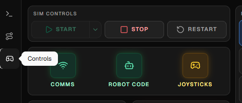
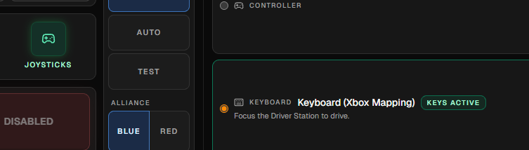
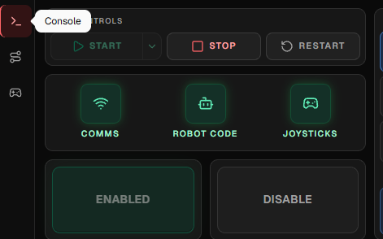

# Timed Robot

In lessons 4 to 6, all of your code ran **once**, when the robot program started. A real
robot program doesn't run from top to bottom once and then stop. Instead, the robot calls
certain methods for you at certain times. In this lesson you'll use two of them:

| Method             | When it runs                                                      |
| ------------------ | ----------------------------------------------------------------- |
| `teleopInit()`     | **once**, each time you click **Enable**                          |
| `teleopPeriodic()` | **over and over** while the robot is enabled, about every 20 ms   |

20 ms is 20 milliseconds, or 0.02 seconds. That's 50 times every second!

## What you're making

A robot program that shows the difference between code that runs once and code that runs
every loop. You'll log which method is running, blink a pretend LED on a timer, and log
live controller input (a button and a joystick), then watch all of it change in
AdvantageScope.

## Where does my code go?

You'll work in one file: **`RobotContainer.java`**, in the `src/main/java/frc/robot/` folder.
It has three spots marked with comments:

- `// Put your fields here.` near the top of the class. Fields are values the robot
  remembers from one loop to the next. You'll add some in steps 3, 4, and 5.
- Inside the braces after `public void teleopInit()`. Code here runs once, each time you
  click **Enable**.
- Inside the braces after `public void teleopPeriodic()`. Code here runs over and over while
  the robot is enabled.

`Robot.java` calls `teleopInit()` and `teleopPeriodic()` at the right times, so you don't need
to edit it.

## How to run your code

Robot projects don't use the Run button. Use the **Driver Station** at the bottom of the page:

1. Click **Start**.
2. Wait for **Comms** and **Robot Code** to turn green.
3. Click **Enable**. Your `teleopInit()` and `teleopPeriodic()` code only runs while the
   robot is enabled.

After you change your code, click **Restart** to run the new version, then click **Enable**
again.

## Steps

### 1. Log a value in `teleopInit()`

Open `RobotContainer.java`. `Logger.recordOutput` sends a value to AdvantageScope. It needs
an import, so add this line at the top of the file, under `package frc.robot;`:

```java
import org.littletonrobotics.junction.Logger;
```

Then add this inside `teleopInit()`:

```java
Logger.recordOutput("RobotState", "TeleopInit");
System.out.println("Teleop started!");
```

- The first part of `recordOutput` is the name (the **key**) the value shows up under. The
  second part is the value to send.
- `System.out.println` prints a line in the Driver Station's console.

> **Check your work:** click **Restart**, wait for **Comms** and **Robot Code** to turn
> green, then click **Enable**. The console should print `Teleop started!` **once**. Click
> **Disable**, then **Enable** again. It prints one more time, because `teleopInit()` runs
> each time you enable.

### 2. Log a value in `teleopPeriodic()`

Add this inside `teleopPeriodic()`:

```java
Logger.recordOutput("RobotState", "TeleopPeriodic");
```

It's the **same** key as in step 1, `"RobotState"`, but with different text.

> **Check your work:** click **Restart**, then **Enable**. Click **AdvantageScope** in the top
> bar of CodeRunner. In the list on the left, open `AdvantageKit`, then `RealOutputs`.
> `RobotState` should say `TeleopPeriodic`.

You'll never see `RobotState` say `TeleopInit` in AdvantageScope, even though the console
shows that `teleopInit()` ran. When you click **Enable**, the robot runs `teleopInit()` and
then `teleopPeriodic()` right after it, in the same loop. AdvantageScope only gets one value
for each key per loop, the last one. So `TeleopPeriodic` replaces `TeleopInit` before it's
ever sent.

> **Think about it:** click **Disable**. What does `RobotState` say now? Why doesn't it
> change?

### 3. Blink an LED every loop

A `boolean` is `true` or `false`. You'll use one as a pretend LED: `true` means on, `false`
means off.

The LED needs to **remember** whether it's on from one loop to the next, so it has to be a
**field**. Add this under the `// Put your fields here.` comment:

```java
private boolean ledOn = false;
```

Then add this inside `teleopPeriodic()`, under your `RobotState` line:

```java
ledOn = !ledOn;
Logger.recordOutput("LED/On", ledOn);
```

- `!` flips a boolean: `!false` is `true`, and `!true` is `false`.
- `ledOn = !ledOn;` sets `ledOn` to the opposite of what it was. So the LED turns on in one
  loop, off in the next, and on again in the one after that.

> **Common mistake:** creating the boolean *inside* `teleopPeriodic()`, like
> `boolean ledOn = false;`. Then it's created fresh every loop, starting at `false`, so it
> flips to `true` every single time and never changes.

> **Check your work:** click **Restart**, then **Enable**.
>
> 1. In AdvantageScope, click the **Line Graph** tab. Under the graph are three sections:
>    **Left Axis**, **Discrete Fields**, and **Right Axis**.
> 2. In the list on the left, open `RealOutputs`, then `LED`.
> 3. Drag `On` from the list and drop it on the **Discrete Fields** section. A striped bar
>    shows up on the graph.
> 4. Scroll up over the graph to zoom in. The bar should switch between `true` and `false`
>    on every loop.

> **Think about it:** how many times a second does your LED flip? Could a person even see a
> real LED blinking that fast?

### 4. Blink more slowly with a timer

`Timer.getFPGATimestamp()` tells you how many seconds have passed since the robot program
started. It needs an import, so add this at the top of the file, under your `Logger` import:

```java
import edu.wpi.first.wpilibj.Timer;
```

To flip only every half second, the robot has to remember *when* the LED last flipped. Add
this field under `ledOn`:

```java
private double lastFlipTime = 0;
```

Now **replace** the two lines from step 3 (`ledOn = !ledOn;` and the `LED/On` line) with
this:

```java
double secondsSinceFlip = Timer.getFPGATimestamp() - lastFlipTime;
if (secondsSinceFlip > 0.5) {
  ledOn = !ledOn;
  // TODO: remember the time of this flip in lastFlipTime
}
Logger.recordOutput("LED/On", ledOn);
Logger.recordOutput("LED/SecondsSinceFlip", secondsSinceFlip);
```

- Subtracting two times tells you how long it's been. If the program has been running for
  `10.3` seconds and the LED last flipped at `10.0`, then `secondsSinceFlip` is `0.3`.
- The `if` only flips the LED once more than half a second has passed.

Replace the `TODO` with a line that sets `lastFlipTime` to the time right now. Use
`Timer.getFPGATimestamp()` to get it.

> **Common mistake:** skipping the `TODO`. Then `lastFlipTime` stays `0`, so after the first
> half second, `secondsSinceFlip` is always more than `0.5`, and the LED goes back to
> flipping every loop.

> **Check your work:** click **Restart**, then **Enable**. On the line graph, `LED/On` should
> now stay `true` for half a second, then `false` for half a second, and so on. Then drag
> `SecondsSinceFlip` onto the **Left Axis** section. It should climb up to `0.5`, drop back to
> `0`, and climb again.

> **Think about it:** how would you make the LED blink once every 2 seconds instead?

### 5. Create an Xbox controller

To read a controller, you create an object for it. The class is called `XboxController`, and
it needs an import. Add this at the top of the file, under your other imports:

```java
import edu.wpi.first.wpilibj.XboxController;
```

Then add this field under your other fields:

```java
private final XboxController controller = new XboxController(0);
```

The `0` is the controller's **port**: which slot it's in on the Driver Station. The first
controller is port `0`.

> **Think about it:** why create the controller as a field instead of inside
> `teleopPeriodic()`? How many controller objects would you make in one minute of driving?

### 6. Log whether the A button is pressed

`XboxController` has a method for every button and stick:

| Method                                         | Gives you                                      |
| ---------------------------------------------- | ---------------------------------------------- |
| `getAButton()`                                 | `true` while A is held down, otherwise `false` |
| `getBButton()`, `getXButton()`, `getYButton()` | the same for B, X, and Y                       |
| `getLeftX()`                                   | the left stick's left/right position, -1 to 1  |
| `getLeftY()`                                   | the left stick's up/down position, -1 to 1     |

Add this inside `teleopPeriodic()`, under your LED lines:

```java
Logger.recordOutput("Controller/A", controller.getAButton());
```

The value is whatever `getAButton()` returns, so it's `true` while A is held down.

Now try it out with your keyboard:

1. Click **Restart** and wait for **Comms** and **Robot Code** to turn green.
2. Click the **Controls** tab on the left side of the Driver Station.

   

3. Choose **Keyboard (Xbox Mapping)**. Check that the **Joysticks** light turns green.

   

4. Click the **Console** tab to go back. Make sure **Joysticks** is still green, then click
   **Enable**.

   

5. Click on the Driver Station, then hold down **K**. That's the A button.

> **Common mistake:** pressing the keys while your code is open and selected. The letters get
> typed into your code instead of pressing buttons. Click on the Driver Station first, then
> press the keys.

> **Check your work:** in AdvantageScope, open `RealOutputs`, then `Controller`. `A` should be
> `true` only while you're holding **K**.

### 7. Log a joystick value

Add this inside `teleopPeriodic()`, under your `Controller/A` line:

```java
Logger.recordOutput("Controller/LeftY", controller.getLeftY());
```

On the keyboard, **W** pushes the left stick up and **S** pushes it down.

> **Check your work:** click **Restart**, then **Enable**, and click on the Driver Station. In
> AdvantageScope, `Controller/LeftY` should be `0` when you aren't pressing anything. Hold
> **W**, then hold **S**, and watch it change. (A keyboard key can only push the stick all the
> way, so you'll only see `-1`, `0`, and `1`. A real controller gives every number in
> between.)

> **Think about it:** pushing the stick *up* gives `-1`, not `1`. That surprises most people!
> What could you put in front of `controller.getLeftY()` so that up gives `1` instead? This is
> why robot code often has a minus sign there.

## Bonus

- **Make a boolean that's `true` only when all four face buttons are pressed.** `&&` means
  "and": the result is `true` only if both sides are `true`. Start with this in
  `teleopPeriodic()`, and add the X and Y buttons to the end with more `&&`:

  ```java
  boolean allFaceButtons = controller.getAButton() && controller.getBButton();
  Logger.recordOutput("Controller/AllFaceButtons", allFaceButtons);
  ```

  Test it by holding **K**, **L**, **J**, and **I** together.

- **Drive a pretend robot around the field with the left stick.** A `Pose2d` is a robot's
  position on the field (x and y in meters) plus which way it's facing. Add these imports:

  ```java
  import edu.wpi.first.math.geometry.Pose2d;
  import edu.wpi.first.math.geometry.Rotation2d;
  ```

  Add this field, so the robot remembers where it is between loops:

  ```java
  private Pose2d pose = new Pose2d(2.0, 3.0, Rotation2d.kZero);
  ```

  Then add this inside `teleopPeriodic()`:

  ```java
  double newX = pose.getX() + controller.getLeftX() * 0.05;
  double newY = pose.getY(); // TODO: move y with the stick too
  pose = new Pose2d(newX, newY, Rotation2d.kZero);
  Logger.recordOutput("Pose", pose);
  ```

  A `Pose2d` can't be changed after it's made, so to "move" it you make a *new* `Pose2d` from
  the old one's values. The `0.05` keeps it slow: the stick goes up to `1`, and the loop runs
  50 times a second, so adding a whole meter every loop would be very fast!

  Replace the `TODO` so the robot moves up and down too, using `getLeftY()`. Then, in
  AdvantageScope, click the **2D Field** tab and drag `Pose` onto the **Poses** section.
  Drive with **W**, **A**, **S**, and **D**. Does pushing up move the robot the way you
  expect? (Look back at the end of step 7.)
